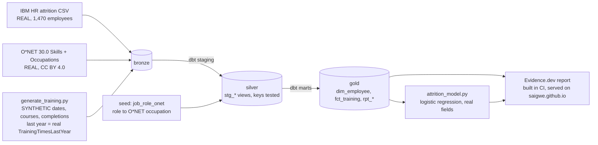

# People & Training Analytics

[](https://github.com/Saigwe/people-training-analytics/actions/workflows/ci.yml)

> Learning and development analytics: training cost per employee, a competency-gap matrix and attrition cohorts by training history, plus a recruitment funnel with structured interview scoring and interviewer calibration.

**Author:** Stanley Igwe, Lead Data (Analytics) Engineer · [Portfolio](https://saigwe.github.io)
**Stack:** dbt Core · DuckDB · statsmodels · Evidence.dev
**Status:** ✅ Built on real IBM and O*NET data, with labelled synthetic training and recruitment data. `dbt build` 79/79, pytest 4/4, CI green.
**Live report:** [saigwe.github.io/reports/people-training](https://saigwe.github.io/reports/people-training/) (Evidence.dev)

Project 20 of my portfolio plan. As an HR analyst at a Nigerian electricity distribution company I built L&D analytics (a training dashboard and cost per employee), a technician competency matrix and structured interview scoring for recruitment, and helped run the company's first recruitment of 200+ electricity sales representatives. This repo rebuilds the problem on public and synthetic data. No employer or client data, code or logic is used.

---

## 90-second summary
| | |
|---|---|
| **Problem** | HR and L&D leads spend money on training without knowing what it costs per head, which skill gaps it closes, or whether trained people stay longer. |
| **What I built** | A dbt warehouse that joins IBM's 1,470-employee attrition file to O*NET's required skill levels for each role, adds a seeded five-year course history that matches IBM's real training counts, and produces cost per employee, a role-by-skill gap matrix and attrition cohorts, plus a logistic regression and an Evidence.dev report. |
| **Why it matters** | "Which roles are furthest from what the job needs, what are we spending per person to close it, and is training linked to people staying?" |
| **Proof** | Employees with no training last year left at **27.8%**, against **10.9%** for 5-6 trainings (real). Holding overtime, income, satisfaction and 13 other factors equal, each extra training goes with **16% lower odds of leaving** (OR 0.84, 95% CI 0.73-0.97). See [Numbers](#numbers). |

## Architecture


## Data
| Source | What | Licence | Real or synthetic |
|---|---|---|---|
| [IBM HR Analytics Employee Attrition](https://github.com/IBM/employee-attrition-aif360) (`data/emp_attrition.csv`) | 1,470 employees, 35 columns: role, department, level, income, overtime, satisfaction, tenure, `TrainingTimesLastYear`, `Attrition` | IBM sample data (fictional employees made for teaching) | **Real file** |
| [O*NET 30.0](https://www.onetcenter.org/database.html) Skills and Occupation Data | Importance (1-5) and required level (0-7) of 35 skills for 1,016 occupations | CC BY 4.0 | **Real** |
| `ingestion/generate_training.py` | Hire and exit dates, a 35-course catalogue (one per O*NET skill) with cost and hours, 16,520 course completions 2021-2025 | Mine | **Synthetic**, fixed seed |
| `dbt/seeds/job_role_onet.csv` | My mapping of IBM's 9 job roles to O*NET occupations, with the reason for each | Mine | Judgement |

IBM's file is one snapshot: it says how many trainings each person had last year and whether they left, but has no dates or course records. So the synthetic history is anchored to it: tenure sets the hire date, real leavers exit in 2025, and each employee's 2025 completions equal their real `TrainingTimesLastYear` (a dbt test checks all 1,470). 70% of courses target the skills O*NET rates most important for the person's occupation. The attrition analysis uses **only** the real fields.

| Bronze table | Rows | Kind |
|---|---:|---|
| `bronze.ibm_employees` | 1,470 | real |
| `bronze.onet_skills` | 62,580 | real |
| `bronze.onet_occupations` | 1,016 | real |
| `bronze.employee_dates` | 1,470 | synthetic |
| `bronze.course_catalog` | 35 | synthetic |
| `bronze.trainings` | 16,520 | synthetic |

## Data model (gold)
| Model | Grain | Purpose |
|---|---|---|
| `dim_employee` | employee | Real IBM attributes, synthetic dates, the role's O*NET occupation, training band |
| `fct_training` | course completion | Cost, hours, format, skill, year, department |
| `rpt_training_cost_per_employee` | year × department | Spend and hours divided by **everyone on payroll** in the year, not just people who trained |
| `rpt_competency_requirements` | job role × skill | The role's top 8 O*NET skills by importance, with the required level (real) |
| `rpt_competency_gap_matrix` | job role × skill | Average achieved level, average gap, share meeting the requirement, share trained on the skill (active staff) |
| `rpt_attrition_by_training` | department × training band | Real attrition rate by trainings last year (0, 1-2, 3-4, 5-6) |
| `fct_application` | application | SYNTHETIC. Furthest stage reached, the date of each stage, days to offer and to start |
| `rpt_recruitment_funnel` | role or source × stage | Applications reaching each stage, conversion from the stage before, and share of applicants |
| `rpt_interviewer_calibration` | interviewer | Average offset from co-panellists on the same candidate and competency, with a 95% CI and a lenient / harsh / calibrated flag |
| `fct_interview_result` | interviewed candidate | Raw and calibrated panel averages, rank in the requisition, whether the offer decision would change, first-year outcomes |

Achieved competency is not recorded anywhere in the public data, so the gap matrix uses a transparent synthetic model, written out in the SQL: required level × a factor from job level, total experience and performance rating, plus 0.3 levels per course completed on that skill, capped at 7.

## Tests in place
- **Staging:** `unique` / `not_null` on every key; `relationships` from employees to the role mapping, from the mapping to O*NET occupations, and from completions to employees and courses; accepted values for department and course format
- **Grain:** `unique_combination` on every report and on O*NET occupation × skill
- **Business rules:**
  - `assert_training_within_employment`: no completion before hire or after exit
  - `assert_last_year_trainings_match_ibm`: each employee's last-year completions equal IBM's real `TrainingTimesLastYear`
  - `assert_gap_matrix_covers_every_active_employee`: each role has 8 skill rows covering its whole active headcount
- **Recruitment:**
  - `assert_funnel_never_widens`: no stage has more applications than the one before, in any cut, and every application's stage dates run forward
  - `assert_calibration_finds_the_planted_interviewers`: the calibration report flags exactly the interviewers the generator miscalibrated, in the right direction, and nobody else
- **pytest:** the synthetic history is byte-for-byte reproducible from its seed; only real leavers have exit dates; gap shares are proportions; the model reports the training odds ratio with a valid CI

## Recruitment funnel and interview calibration (synthetic)
There is no open dataset of applications and interview scores, so `ingestion/generate_recruitment.py` builds one with a fixed seed:
- **Requisitions:** 30 in 2024–2025 for the IBM job roles, including one mass-hiring campaign for 220 sales representatives.
- **Funnel:** 3,882 applications from five source channels.
- **Interviews:** structured panels of three interviewers scoring four rubric competencies (communication, problem solving, customer focus, integrity and safety) from 1 to 5.
- **Planted:** two of the 14 interviewers are miscalibrated (one lenient, one harsh), and offers were made on raw panel averages, as many teams do. The answer key is used only by the test.

| Stage | Applications | Conversion from previous |
|---|---:|---:|
| Applied | 3,882 | |
| Screened | 2,297 | 59.2% |
| Assessed | 1,533 | 66.7% |
| Interviewed | 1,312 | 85.6% |
| Offered | 348 | 26.5% |
| Accepted | 281 | 80.7% |
| Started | 271 | 96.4% |

| Source channel | Applicants | Hired | Hire rate |
|---|---:|---:|---:|
| Referral | 618 | 63 | 10.2% |
| Campus | 287 | 27 | 9.4% |
| Agency | 471 | 34 | 7.2% |
| Careers site | 985 | 71 | 7.2% |
| Job board | 1,521 | 76 | 5.0% |

The sales campaign took 2,107 applications for 194 starters, with a median of 23.5 days from application to offer and 51 days to start.

**Calibration.** For every score, the offset is the score minus the average the other two panellists gave the same candidate on the same competency, so candidate quality cancels out:

| Interviewer | Scores | Mean offset (95% CI) | Flag | Planted |
|---|---:|---|---|---:|
| I07 | 1,100 | +0.84 (+0.80 to +0.89) | lenient | +0.9 |
| I11 | 1,008 | −0.88 (−0.93 to −0.83) | harsh | −0.8 |
| The other 12 | 952–1,216 each | between −0.06 and +0.04 | calibrated | 0 |

The two found are exactly the two planted, and nobody else is flagged. 484 of the 1,312 interviewed candidates had one of them on their panel. Re-ranking each requisition on calibrated averages **changes 82 offer decisions**: 41 candidates who got offers wouldn't have, and 41 who didn't would have.

**What it can't show.** Among the 271 starters, the calibrated average doesn't predict first-year performance better than the raw one (correlation 0.19 vs 0.21). With 271 people that difference is noise, and only hired candidates have outcomes, which compresses both scores. The case for calibration here is fairness between candidates, not a proven gain in prediction.

## Numbers
All from `make all` on the real files, 26 Oct 2026, on a Windows laptop.

**Attrition by trainings last year (real IBM data)**

| Trainings last year | Employees | Leavers | Attrition |
|---|---:|---:|---:|
| 0 | 54 | 15 | 27.8% |
| 1-2 | 618 | 107 | 17.3% |
| 3-4 | 614 | 95 | 15.5% |
| 5-6 | 184 | 20 | 10.9% |

**Logistic regression (real IBM data, 1,470 employees, 237 leavers, pseudo R² 0.29)**

| Term | Odds ratio | 95% CI | p |
|---|---:|---|---:|
| Each extra training last year, unadjusted | 0.878 | 0.785-0.982 | 0.023 |
| Each extra training last year, **adjusted** | **0.841** | **0.733-0.966** | **0.014** |
| Works overtime | 5.875 | 4.129-8.361 | <0.001 |
| Each point of job satisfaction (1-4) | 0.684 | 0.588-0.795 | <0.001 |

Adjusted for overtime, job level, log income, age, tenure, years since promotion, prior employers, commute, stock options, job / environment satisfaction, work-life balance, job involvement, marital status, travel and department. It is an association in one snapshot: people who are already planning to leave may also skip training.

**Training cost per employee on payroll (synthetic history)**

| Year | On payroll | Spend | Per employee | Share who trained |
|---|---:|---:|---:|---:|
| 2021 | 1,009 | £1,891,847 | £1,875 | 88.9% |
| 2023 | 1,289 | £2,411,888 | £1,871 | 89.0% |
| 2025 | 1,470 | £2,868,838 | £1,952 | 96.3% |

**Competency gaps (required levels real, achieved levels synthetic; 1,233 active staff)**

| Role | Active staff | Avg gap (levels) | Skill requirements met |
|---|---:|---:|---:|
| Research Scientist | 245 | 1.10 | 2.1% |
| Sales Representative | 50 | 0.99 | 2.3% |
| Laboratory Technician | 197 | 0.80 | 4.1% |
| Manager | 97 | 0.02 | 91.1% |

| Pipeline | Value |
|---|---|
| Rows processed (real) | 65,066 bronze rows from 12 MB of source files |
| Synthetic rows generated | 18,025 training + 29,851 recruitment |
| dbt | 19 models + 1 seed, 59 data tests: 79/79 pass |
| Full `make all` | 17 s |

## Evidence.dev report
[saigwe.github.io/reports/people-training](https://saigwe.github.io/reports/people-training/) shows headline tiles, cost per employee by year and department, the gap heatmap, attrition cohorts and the regression table. The report reads small CSV exports of the gold tables (`reports/sources/people`, written by `make report-data`), so CI can build it without the raw data. On every push to `main`, the `report` job builds the static site and publishes it to this repo's `report-site` branch; the portfolio site serves a copy of that build.

## How to run
Requires **Python 3.12** (what CI uses) and `make`, or run the commands in the `Makefile` by hand.
```bash
python -m venv .venv && source .venv/bin/activate   # Windows: .venv\Scripts\activate
pip install -r requirements.txt
make fixture-all   # synthetic stand-ins for IBM and O*NET -> history -> dbt build -> model -> pytest (CI)
make all           # real data: download the files first, see ingestion/README.md
cd reports && npm install && npm run sources && npm run dev   # the Evidence report (Node 18+)
```

## Roadmap
- [x] Scaffold: synthetic fixture, staging with key tests, first marts and business-rule tests, CI
- [x] Load the IBM attrition data and generate training history
- [x] Training cost per employee by year and department
- [x] Competency-gap matrix: required vs completed competencies by job family
- [x] Attrition cohorts: trained vs not trained
- [x] Evidence.dev report
- [x] Fill in [Numbers](#numbers) and the [design doc](docs/design_doc.md)
- [x] Recruitment funnel, structured interview scoring and interviewer calibration, with an answer key
- [ ] 3-minute Loom walkthrough ([script ready](docs/walkthrough.md))

## Interview topics this project prepares
- HR metrics: why cost per employee divides by everyone on payroll, and how leavers enter the denominator
- Cohort analysis, and confounding: the raw cohort gap vs the adjusted odds ratio
- Many-to-many modelling: employees to courses to skills to occupations
- Being honest about synthetic data: anchoring it to real fields and testing that it stays anchored
- Recruitment: funnel conversion by source, structured interviews, and calibrating interviewers against their co-panellists

## Data and licence
- **IBM HR Analytics Employee Attrition:** sample data published by IBM; it describes fictional employees.
- **O*NET 30.0:** © U.S. Department of Labor, Employment and Training Administration, used under [CC BY 4.0](https://creativecommons.org/licenses/by/4.0/). Modified: pivoted, filtered to 9 occupations and ranked.
- **Synthetic data:** generated with fixed seeds by `ingestion/generate_training.py`, `ingestion/generate_recruitment.py` and `tests/fixtures/make_fixture.py`. It describes no real company or person.
- **Code:** MIT (see `LICENSE`).
