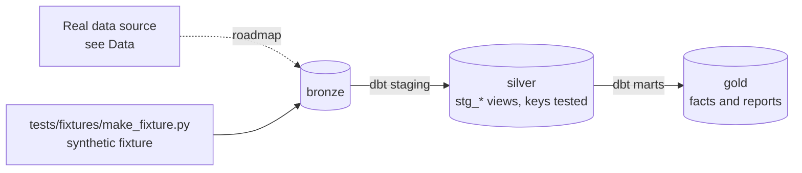

# People & Training Analytics

[](https://github.com/Saigwe/people-training-analytics/actions/workflows/ci.yml)

> Learning and development analytics: training cost per employee, a competency-gap matrix and attrition cohorts by training history.

**Author:** Stanley Igwe, Lead Data (Analytics) Engineer · [Portfolio](https://saigwe.github.io)
**Stack:** dbt Core · DuckDB · Evidence.dev
**Status:** 🚧 Scaffolded. Fixture pipeline passes: `dbt build` 16/16. See [Roadmap](#roadmap).

Project 20 of my portfolio plan. As an HR analyst at a Nigerian electricity distribution company I built L&D analytics (a training dashboard and cost per employee) and a technician competency matrix. This repo rebuilds the problem on public and synthetic data. No employer or client data, code or logic is used.

---

## 90-second summary
| | |
|---|---|
| **Problem** | TODO: one sentence on the business problem. |
| **What I built** | TODO: fill in as the roadmap lands. |
| **Why it matters** | TODO: the decision this enables, in the user's words. |
| **Proof** | TODO: link to [Numbers](#numbers), with every claim reproducible. |

## Architecture


## Data
Real data: [IBM HR Analytics Attrition](https://www.kaggle.com/datasets/pavansubhasht/ibm-hr-analytics-attrition-dataset), plus synthetic training records. CI uses a synthetic departments, employees and trainings fixture.

| Bronze table (fixture) | Rows |
|---|---|
| `bronze.departments` | 5 reference rows |
| `bronze.employees` | 600 |
| `bronze.trainings` | 3,000 |

## Data model (gold layer, first cut)
| Model | Purpose |
|---|---|
| `rpt_training_cost_per_employee` | Training spend per employee by year and department (employees on payroll at any point in the year). |

## Tests in place
- Staging: `unique` / `not_null` on every key, and `relationships` on every foreign key
- Marts: grain tests (`unique_combination`) and accepted values
- Business rules: `assert_training_after_hire`

## Numbers
*(Fill from real runs. Never estimate.)*
| Metric | Value |
|---|---|
| Rows processed (real data) | _tbd_ |
| dbt models / tests | _tbd_ |
| `dbt build` runtime | _tbd_ |

## How to run
Requires **Python 3.12** (what CI uses) and `make`, or run the commands in the `Makefile` by hand.
```bash
python -m venv .venv && source .venv/bin/activate   # Windows: .venv\Scripts\activate
pip install -r requirements.txt
make fixture-all   # synthetic fixture -> dbt build (used in CI)
```

## Roadmap
- [x] Scaffold: synthetic fixture, staging with key tests, first marts and business-rule tests, CI
- [ ] Load the IBM attrition data and generate training history
- [ ] Training cost per employee by year and department
- [ ] Competency-gap matrix: required vs completed competencies by job family
- [ ] Attrition cohorts: trained vs not trained
- [ ] Evidence.dev report
- [ ] Fill in [Numbers](#numbers) and the [design doc](docs/design_doc.md)
- [ ] 3-minute Loom walkthrough

## Interview topics this project prepares
- HR metrics
- Cohort analysis
- Many-to-many modelling

## Data and licence
- **Fixture:** synthetic, generated with a fixed seed by `tests/fixtures/make_fixture.py` from `fixture_spec.yml`. It describes no real company or person.
- **Real data:** see [Data](#data) for each source's own licence and terms.
- **Code:** MIT (see `LICENSE`).
